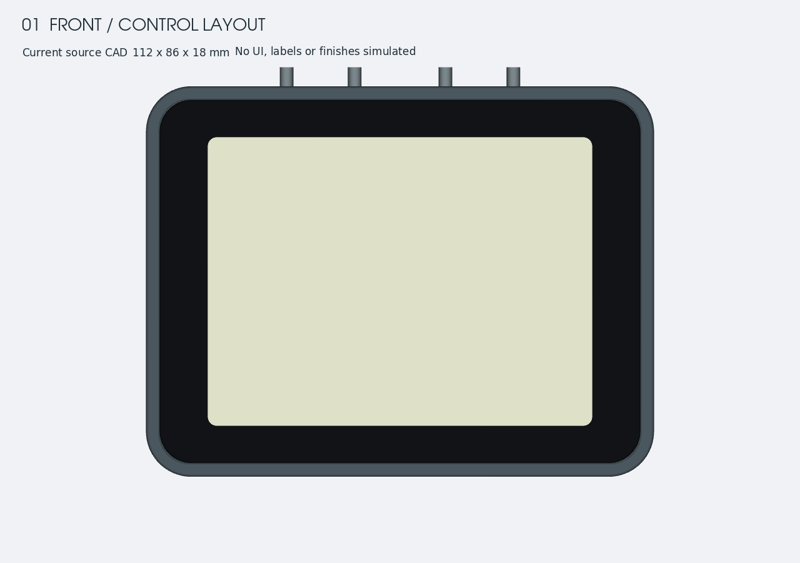
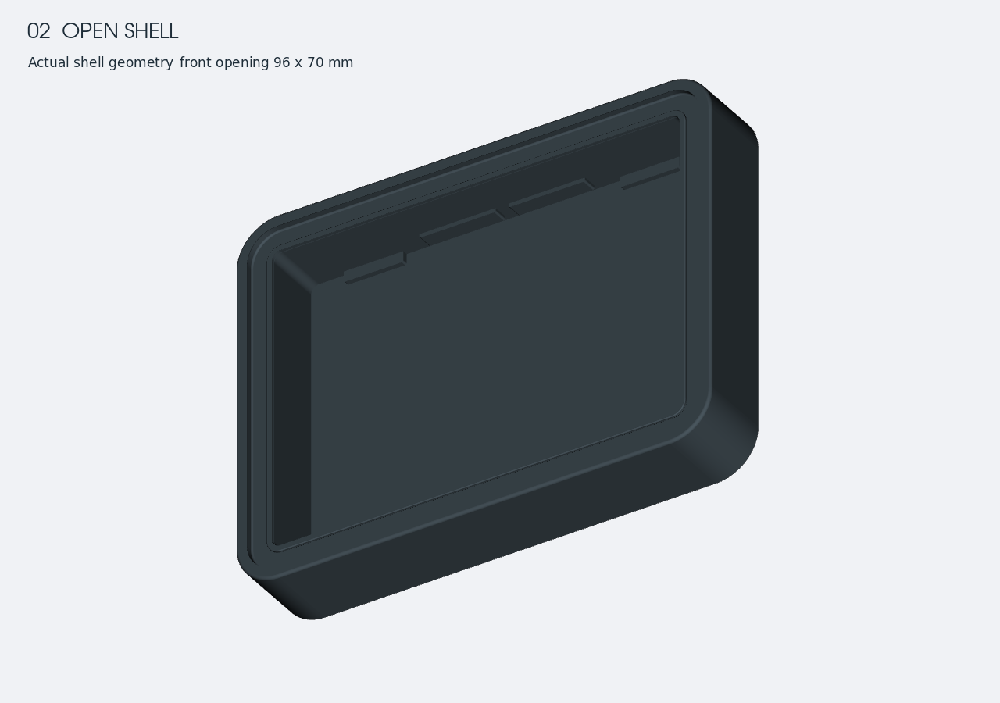
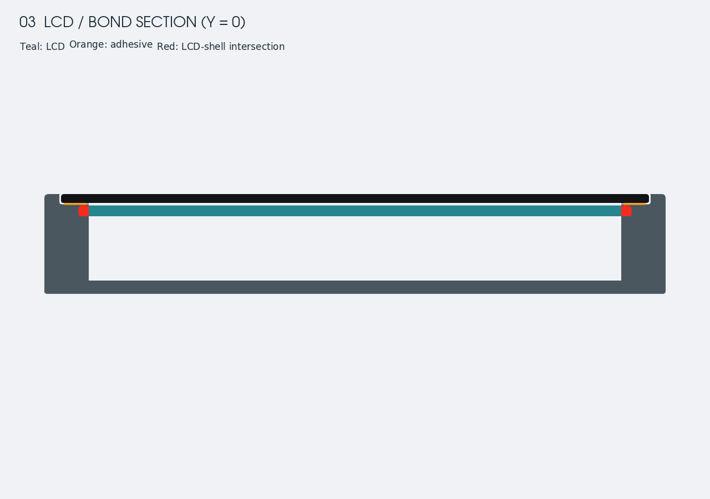
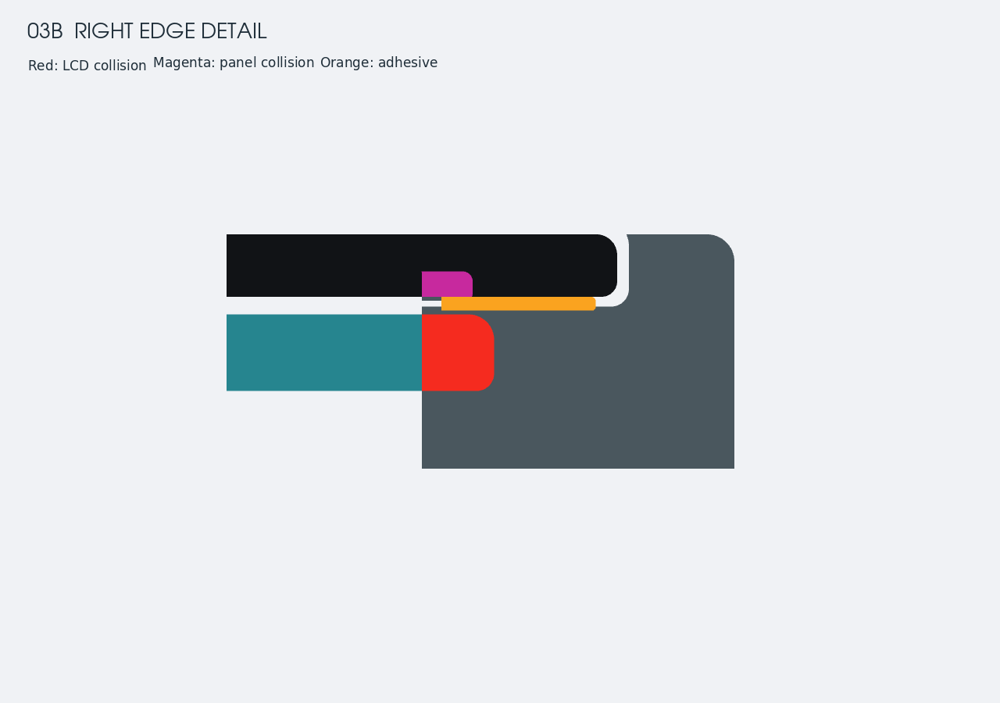
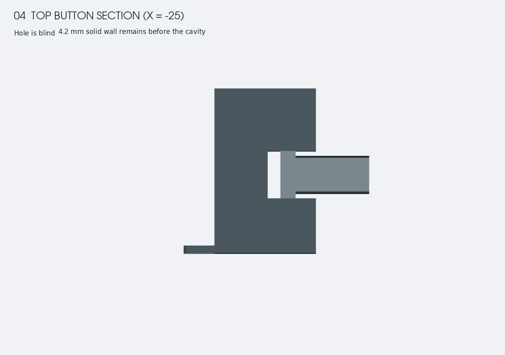
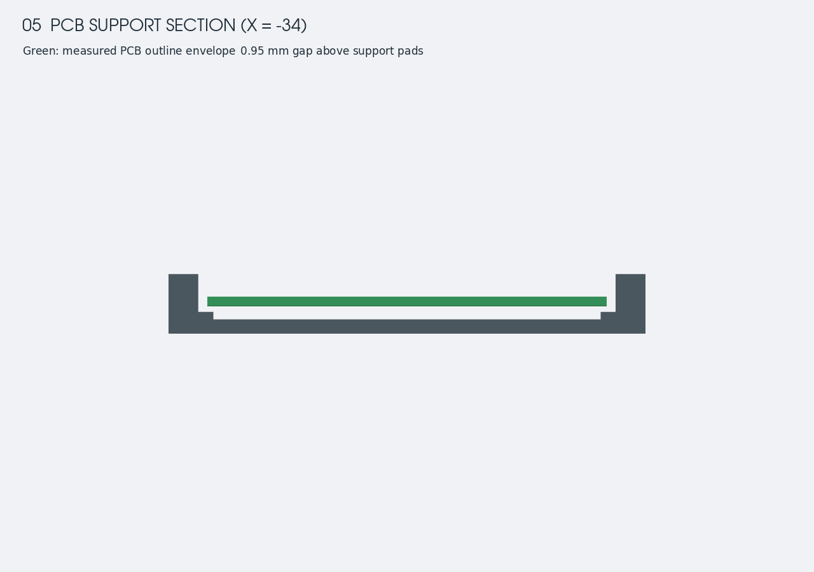

# Trace Compass v1 外壳审查

日期：2026-09-30。范围：`硬件/trace-compass/v1` 当前参数化 CAD、导出零件 STEP、设计说明。只审查该版本。

**结论：外观方向值得保留，但当前模型尚不能作为可装配、可密封的定版结构。** 紧凑横屏、完整正面和顶部按键形成了清楚的产品方向；优先工作是修正内腔、面板胶接、按键传力和 PCB 固定，再完善操作辨识。

这是实体产品的 CAD 设计审查。以下视图由本次运行的原始几何生成，已经逐张打开检查；不是实物照片，也不是软件界面截图。渲染色用于区分零件，不代表最终材料与表面效果。未修改产品 CAD 或已有 STEP。

## 审查步骤与状态

| 步骤 | 检查内容 | 状态 |
|---|---|---|
| 1 | 正面比例与按键辨识 | 外形良好；操作辨识待完善 |
| 2 | 开壳、内腔与前装路径 | 存在阻碍装配的尺寸冲突 |
| 3 | LCD、面板与胶接剖面，含局部放大 | 不通过：刚性零件发生干涉 |
| 4 | 顶部按钮剖面 | 不通过：孔未贯通、密封与传力未闭合 |
| 5 | PCB 支撑剖面 | 不通过：支撑未接触板底，缺少明确固定方式 |

## 1. 正面比例与操作

值得保留：主体 112 × 86 × 18 mm，圆角与完整前面板使外形简洁。按 LCD AA 尺寸计算，左右边框各约 13.6 mm、上下各约 11.2 mm，视觉较均衡。把按键放在顶部，使正面保持连续、不会占用显示区域。按钮使总高度约为 90.2 mm，安装包络应包括这部分突出量。

**P2｜四个按键难以凭触觉区分。** 当前 CAD 中四个触头均为 Ø3 mm，中心距 15 / 20 / 15 mm，没有功能标识或差异形状。不能据此断言实物难用，但湿手、手套和不看按键时的命中率值得优先验证。建议以真实操作频率确定主键，提供更明确的接触面、形状或触觉标记，并在可见正面边缘提供功能映射。尺寸应通过 1:1 样件验证，不在本次审查里假定最终值。

屏幕目前只是空白显示参考面，且为了可视化被置于前面板之上。不能从此视图推断实际字高、远距离可读性、反射、偏振镜兼容性或最终遮光边界。窗口与 AA 每侧仅有 1.6 mm（横向）、1.2 mm（纵向）余量，应在最终光学叠层里核对遮挡与偏视。

## 2. 内腔与前装路径

**P1｜LCD 与壳体发生确定的干涉。** 内腔按服务开口直接切成 96 × 70 mm；LCD 模组为 99.7 × 69.34 mm。LCD 在 X 方向每侧超出内腔 1.85 mm，实际布尔求交体积约 **476.39 mm³**。这不只是插入角度问题：最终位置本身已与壳体相交。

根因是 `wall=2.8` 没有用于台阶下方内腔切除；当前主要侧壁实际达到约 8 mm。修订应联合考虑可通过的前装开口、模组最终腔体与胶接宽度。仅在内部掏宽，仍不能证明 LCD 能沿前装路径进入。若扩大开口，需要重新核对剩余胶接面积；若调整壳宽，需要同时检查按键与板件位置。

源码：`trace_compass_v1_enclosure.py:181`，特别是 `196–203` 的内腔切除。

## 3. LCD、面板与胶接截面

青色为 LCD，橙色为胶层；红色为 LCD 与壳体相交，紫红色为面板与壳体相交。

**P1｜面板、台阶和胶层的高度不一致。** 面板底面 z=16.40 mm；内侧凸环从 z=16.30 延伸到 17.05 mm，与面板发生约 **276.42 mm³** 的刚性干涉。即使暂时不考虑凸环，凹槽底 z=16.15 到面板底只有 0.25 mm，而胶层定义为 0.35 mm。胶层与壳体相交约 **159.69 mm³**。

建议先确定最终装配的面板高度、固化或压缩后的胶厚、胶接台面和限位结构，再建立统一截面。若 0.35 mm 意图表示未压缩胶厚，需另行表达装配状态；目前模型没有这一说明，且不能解释刚性面板与凸环的干涉。连续胶环是合理的设计意图，但当前模型不能证明存在可实现的连续密封。

源码：`trace_compass_v1_enclosure.py:185`、`:205`、`:264`、`:279`。

## 4. 顶部按钮

**P1｜按钮孔是盲孔，按钮无法按当前结构向内传力。** 孔从 y=44 切到 39.2 mm，而真实内腔边界在 y=35 mm；两者之间仍有 **4.2 mm 实体壁**。硅胶件内端在 y=40.2，仍处在实际壁厚区域内；按钮裙边与壳体的交叠约 **124.41 mm³**。弹性件的交叠可能用于预压，但当前没有对应压紧件与装配变形说明，不能将其直接视为已完成的密封设计。

应以真实开关位置建立“触头—硅胶弹性部分—压紧/密封面—开关”的完整传力路径，同时给出行程、回弹、限位和装配入口。孔要依据真实内壁定位，而不是仅用名义 `wall` 决定切深。设计说明已把按键列为参考件，因此这里是结构完成度的阻碍，不是实物失效结论。

源码：`trace_compass_v1_enclosure.py:220`、`:296`。

## 5. PCB 支撑与固定

绿色仅表示源码所记录的 PCB 板体包络，不代替完整电子器件模型。

**P1｜PCB 未落在支撑垫上，也没有明确的垂直固定。** 板底 z=4.60 mm，支撑顶 z=3.65 mm，间隙 **0.95 mm**。侧边定位筋与板边另有约 0.60 mm 横向间隙，并非扣住 PCB 的结构。按当前描述的“支撑垫＋侧筋”不能解释板件如何保持设计位置。

应把支撑顶面与实际板底统一，检查支撑位置的背面元件禁布，再采用明确的压框、弹性垫、卡扣或其他可验证的固定方式。不能只降低 PCB 来消除间隙，因为现有高度还用于保护背面元件与底壳之间的空间。需要在振动后复查位移，而非仅检查静态放入。

源码：`trace_compass_v1_enclosure.py:173`、`:227`。

## 尚未闭合的使用场景

- USB 被明确设计为封壳前烧录接口，缺少外部 USB 孔不作为缺陷。需要补充封胶前测试、后续固件恢复和返修流程。
- 本版本没有独立电池、充电部件、天线及安装支架的完整装配验证。不能从当前壳体证明这些需求已经解决，也不能直接认定所有这些部件都必须放入壳内。
- 密封后的 microSD 访问方式仍待确定。若最终只通过无线取数据，可继续保持封闭；若要求现场拔卡，就需要重新定义服务路径。
- 顶部按键与最终支架、绑带、绳索的空间关系尚未联合检查。需以安装后的设备核对可达性与误触，而不是仅以裸机判断。

## 证据与验证边界

本次对 shell、panel、adhesive、LCD reference、buttons、display 六类生成几何执行有效性检查，均有效；有效几何不代表可装配。对壳体、面板、胶环和硅胶按钮四个已有 STEP 与重建几何执行双向差集，差集体积均为 0，说明发现也适用于这些导出零件。

数据见 [measurements.json](measurements.json)、[export-verification.json](export-verification.json)。可复现脚本见 [audit_geometry.py](audit_geometry.py)、[verify_exports.py](verify_exports.py)。图片由 VTK 渲染实际 CadQuery 几何；配色仅用于审查。

本次未进行完整 PCB 器件级碰撞检查、FPC 弯折检查、装配运动仿真、制造公差分析、胶材选择、强度计算或实物测试。防水等级、按键寿命、跌落表现、抗紫外线、海上可读性和辅助使用能力均未认证。制造工艺与材料在 v1 中也未充分明确，不能直接沿用原版材料假设判定可制造性。

建议下一步保留现有外观比例，优先完成一版消除上述四类装配问题的结构修订，然后制作 1:1 装配与按键样件。
