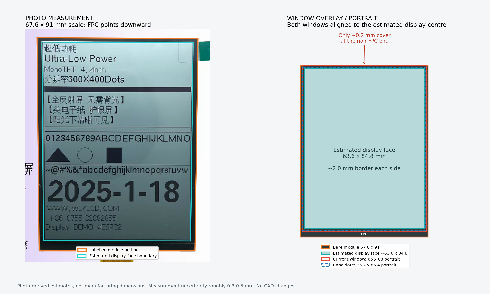

# Compass v2 视窗复审 — 根据用户提供的屏幕照片

2026-10-14。结论：**84.8 × 63.6 mm 显示区尺寸与照片估算吻合，但现有 88 × 66 mm 视窗在窄边处的遮盖余量不足；正视检查通过不代表海上斜视也合适。** 本轮仅审计，未修改产品 CAD、STEP 或原有验证记录。

## 1. 照片测量：尺寸基本吻合，边框明显不对称

使用附件原图，人工选取屏体四角和浅色显示面外缘，将屏体四角透视映射到图中标注的 67.6 × 91 mm 矩形。不将屏幕内部的黑色测试条、文字或细框当作显示边界。

| 部位（按照片竖放、FPC 朝下） | 照片估算 |
|---|---:|
| 裸屏外形，不含 FPC | 67.6 × 91 mm（图片标注） |
| 可见显示面 | 约 63.6 × 84.8 mm |
| 左侧边框 | 约 2.0 mm |
| 右侧边框 | 约 2.0 mm |
| 上侧，远离 FPC | 约 1.8 mm |
| 下侧，FPC 端 | 约 4.4 mm |
| 显示面中心相对裸屏中心 | 向非 FPC 端偏约 1.3 mm |

计算点位为：屏体四角 (383,167)、(903,169)、(893,855)、(390,855)；显示面四角 (399,181)、(887,183)、(879,823)、(404,822)。完整原图另存 `source.png`，原图未修改；对比图的左侧只做坐标显示范围裁切和测量线叠加。

边框值按约 ±0.3–0.5 mm 的照片判读不确定性理解，并非制造公差或统计置信区间。浅色显示面不是经仪器测定的最后一排有效像素；两者是否完全重合仍需厂家尺寸图确认。得到的 63.6 × 84.8 与此前图纸 AA 数值吻合，作为本次估算支持继续使用该 AA 尺寸。

## 2. 现有开窗：不遮正视显示区，但窄边几乎没有余量

v2 采用横装窗口 **88 × 66 mm**，等价于照片方向的 **66 × 88 mm**。若中心与显示面正确对齐：

- 显示区每侧多露出约 1.6 mm（横装长边方向）和 1.2 mm（横装短边方向）。
- 窗口之外剩余的屏体覆盖量，照片方向左/右约 0.8 mm、非 FPC 端约 **0.2 mm**、FPC 端约 2.8 mm。
- 约 0.2 mm 小于本次照片判读不确定性，不能当成可依赖的设计余量。按 v2 已检查过的最大 ±0.75 mm 定位浮动估算，最不利时窗口可能越过裸屏边缘约 0.6 mm，露出屏外结构。

这里的“覆盖量”只是正面光学遮盖，不是屏幕与前保护片之间的密封胶宽。前保护片仍为 98 × 76 mm，独立胶接在壳体上；本次发现不能直接推导防水失效。

源码：`硬件/trace-compass/v2/trace_compass_v2_enclosure.py` 的 `Params.window_w/window_h`、`shell()` 前开孔和 `lens_mask()` 印刷开窗。`lens_mask()` 目前把 88/66 写成常量，后续改尺寸必须同时修改或统一参数，否则壳体孔与印刷窗会不同步。

## 3. 对位与斜视：两项都需要修订或重新验证

### 对位基准

照片中的 91 × 67.6 mm 是裸屏/液晶模组外形；旧版 99.7 × 69.34 mm 是带板的包络，不能拿二者相减后当成同一零件的边框。

照片支持“显示面相对裸屏偏约 1.3 mm”。v2 的 1.95 mm 是此前根据 PCB 图推导的 AA 对 PCB 偏移，**二者不是同一基准，不能直接用 1.3 替换 1.95，也不能把 1.95 直接套到裸屏定位上**。如果实际只装图中的裸屏，须重建其机械定位；如果仍装带板版本，须测出裸屏、AA 与 PCB 之间的相互位置。

### 斜视空间

当前屏幕参考面 z=22.8 mm，透镜内侧印刷遮光面约 z=24.405 mm，距离约 1.605 mm。以空气隙直线投影作简化估算：

| 情况 | 横向开始遮边角度（离法线） | 纵向开始遮边角度（离法线） |
|---|---:|---:|
| 现有 88 × 66，理想居中 | 约 45° | 约 37° |
| 现有窗口，最不利 ±0.75 mm 浮动 | 约 28° | 约 16° |
| 只缩到 86.4 × 65.2，仍保留原间隙，理想居中 | 约 26° | 约 26° |

公式为 `atan((窗口半尺寸 - AA半尺寸 - 不利偏移)/遮光面距离)`。这只是在指定几何下开始遮住边缘像素的估算，不是显示屏自身的可视角认证，也没有模拟光学反射和实际液晶/玻璃叠层。

因此，**不能仅把视窗缩小**。较小开窗能改善露黑边和露底，却会在相同深度下更早遮挡斜视内容。

## 建议的下一版候选

采用横装 **86.4 × 65.2 mm 光学视窗**作为样件起点，AA 四周各留约 0.8 mm。在本次照片估算下，非 FPC 端可保留约 1.0 mm 屏体覆盖，另两侧约 1.2 mm。

与此配套：将 AA 对视窗的定位目标收紧至约 ±0.25 mm，将有效显示面到遮光面的距离目标降低至约 0.5 mm。简化几何下的最不利遮边起点约 48°，比仅缩窗口合理。它们是需要结合实际屏幕厚度与前框重新设计的候选目标，不是本次已经完成的结构尺寸，也不包含制造误差的全公差闭合。

现有 98 × 76 mm 保护片不必因为光学视窗收窄而一并缩小。应分别定义：透明保护片外形、黑色印刷开窗、壳体结构孔，必要时给结构孔做斜面扩口；保持结构孔不额外截断光路。

先前 206 项检查属于在给定屏幕参考参数下的装配几何检查，未检查真实裸屏的边缘覆盖和斜视光路。本次据新提供图片补充这两项，因此不能把原检查通过视为视窗已经定版。

复现：`python docs/compass-window-audit-2026-10-14/measure_window.py`。数值见 `measurements.json`，产品 CAD 保持不变。
