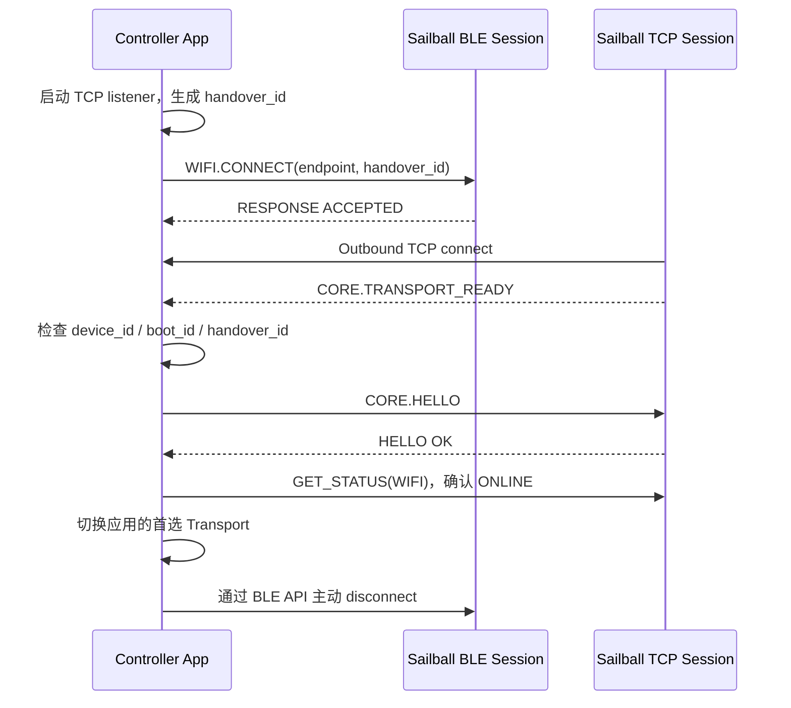
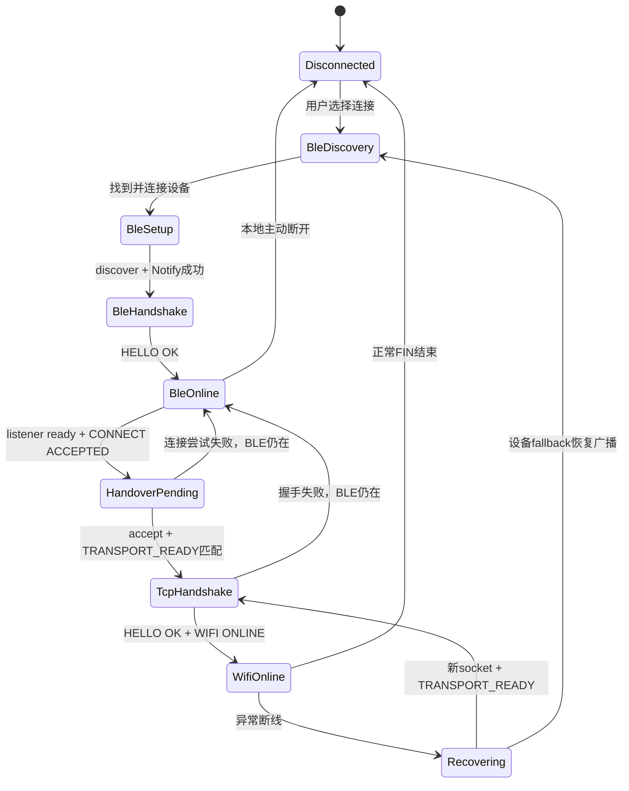

# Sailball Client Interface v1 — 客户端开发指南

**Sailball Protocol v1.0 Frozen Final**

整理日期：2026-09-26 · 适用：USB、BLE、Wi-Fi TCP；Cellular 仅预留

本文从 Controller App / SDK 视角说明如何使用已冻结协议。权威 ID、字段、状态码和权限以 [Sailball Protocol v1](sailball-protocol-v1.0.md) 为准；本文的本地状态机和调度建议不新增线上命令、字段、可靠性机制或认证。项目其他文档见 [索引](README.md)，下载文件的内容格式见 [LDC v1](LDC_v1_Format_Specification-v1.0.md)。

## 1. 客户端职责与实现分层

客户端负责发现与连接设备、建立独立 SP Session、查询当前状态、选择实时流字段、管理 TCP listener 和 Wi-Fi handover、拉取 LDC 文件以及呈现诊断信息。

推荐分层：

```text
应用 UI / 本地导出
       ↓
设备会话管理、权限提示、状态缓存、错误游标、下载任务
       ↓
CORE / GNSS / STORAGE / TRANSFER / WIFI / BLE / DIAGNOSTICS / UI
       ↓
SP Frame + CBOR + request_id 关联
       ↓
USB COBS | BLE fragmentation | TCP COBS
```

客户端不得假设“无线是低权限，所以所有控制都不能做”：无线可查询、live、下载、UI 切页及按矩阵管理其他 Transport；但不能控制 Recorder、重启设备/GNSS、清错误历史或删除/格式化 SD。Wi-Fi source 可以读取 GET_SCAN_RESULTS，但不能进行 SCAN/SET_CONFIG/CONNECT/DISCONNECT/FORGET；BLE source 不能调用 BLE.SET_ADVERTISING/DISCONNECT。

网络慢时降低 live 频率或下载速率，遇 BUSY 让路。不得为了客户端体验自动发 STOP Recorder；USB 拥有权限也不意味着可以隐藏执行有破坏性的操作。

## 2. SP 编解码与请求管理

### 2.1 三层长度

```text
raw file chunk                 = data_length
BULK SP Payload                = 16 + data_length
完整 SP Frame                  = 24 + payload_length + 4
USB/TCP 线上字节                = COBS(Frame) + 0x00
BLE 每片 GATT value             = 6-byte fragment header + fragment bytes
```

先编码 CBOR 或 BULK Payload，再写 24 B LE Header、计算 Header+Payload 的 CRC32C 并追加 LE CRC。然后才执行 Transport 封装。CBOR 不是“小端 struct”；不要用 Header 的 LE 规则替代 CBOR 自身格式。

接收反向处理；只有完整、长度正确、CRC 正确的 SP Frame 才交给 RPC/事件/流处理器。解析器必须拒绝超本地上限的数据，缓冲与待发送队列有界。

### 2.2 Request ID 与 sequence

每 Session 创建独立 pending request 表；request_id 非零，回卷跳过0，不重用仍 pending 的 ID。关联维度应包括 Session 和 request_id，并校验响应 Service/Message；不同 Session 即使 ID 相同也无关。

每方向 sequence 从0开始，uint32 自然回卷；发现 gap 仅计数，不能因此拒绝 CRC 正确的 Frame。sequence 不用于 ACK、重传或去重。

普通 RESPONSE 复用原 request 的 Service/Message；TRANSFER.READ 成功是 **BULK DATA**，其 Message ID 为 TRANSFER 下的 `0x0001`，而原 READ Command 为 `0x0002`。RPC 层必须为这个冻结特例建立预期终结类型，不能按 Message ID 相同的普通 RESPONSE 规则误丢 BULK。

### 2.3 响应和重试

| 收到内容 | 客户端解释 |
| --- | --- |
| `{0: OK, 1: data?}` | 对应同步操作完成 |
| `{0: ACCEPTED}` | 异步操作已提交，之后查询状态 |
| BUSY | 当前无法处理；退避后可重试，不能密集灌请求 |
| PERMISSION_DENIED | 来源无权限，不通过修改 Payload 自报 USB 绕过 |
| INVALID_REQUEST / OUT_OF_RANGE | 修正编码、字段、大小或范围 |
| NOT_FOUND | 文件/handle 等不存在，按具体命令恢复 |
| IO_ERROR / INTERNAL_ERROR | 报告失败，查询状态和诊断 |
| 请求超时 / 断线 | 结果可能未知，不能直接断言“没有执行” |

只有已定义幂等语义的操作才可按该语义重试。START/STOP 的幂等并不意味着所有命令都具备 request 去重。异步请求返回 ACCEPTED 后，不等待第二个同 ID “完成 RESPONSE”；使用状态查询/普通 Event 提醒。

不要发送 `request_id=0` 的 REQUEST。同一 Session 某 request_id 仍 pending 时不要再次发送同 ID；设备不会执行第二次。原请求完成并移出 pending 后可重新使用该 ID，但协议不提供 completed-request replay cache 或 exactly-once 保证。

### 2.4 CBOR 严格性

使用 integer map keys、definite lengths，不发 float/tag/undefined/indefinite。无参数命令发 `{}`，不是空 Payload。Text String 必须有效 UTF-8；SSID/password、device_id、IP/BSSID 是 Byte String。Boolean 不用整数替代。未知可选 key 忽略，已知字段类型错误和重复 key 不容忍。

数值保留整数精度；不要先转换成浮点再往返编码 uint64 时间/文件偏移。没有值时保留“字段缺失”，不要用零或空字符串填充成有效测量。最大 depth=6；最外层 Payload Map 为 depth1，每进入 Array/Map 增加1，标量和字符串不增加结构深度。

## 3. BLE discovery、connect 与 HELLO

### 3.1 发现与 GATT 建链

Sailball 是 Peripheral，App 是 Central。发现目标的自定义 Sailball Service；`Sailball-XXXX` 仅作为用户可读名称，不能代替完整 device_id。广播不用于读取最新 fix/recording 状态。

执行顺序：

1. 建立 BLE connection；最多一个 Controller 与设备连接。
2. Discover Sailball Service、RX WRITE、TX NOTIFY。
3. 协商/读取实际 ATT MTU；不要假设固定 MTU。
4. 成功订阅 TX Notify。
5. 初始化本 BLE Session 的序列与请求表，发送 CORE.HELLO。
6. HELLO 成功后进入 BLE SP ONLINE，再查询状态和订阅普通 Event。

v1 固定 UUID：Service `ff26c6cf-0ed6-51c9-810d-b7bcfd0a9573`；RX WRITE `dc7fc9d8-c2cf-51e8-8c75-5aaef0042d68`；TX NOTIFY `0653875c-6670-562b-be88-54c11297fba7`。不得由 SDK 随机生成。v1 不要求 pairing/bonding，也没有应用层认证流程。

### 3.2 BLE 分片

每个 GATT value：`uint16 frame_id + uint16 offset + uint16 total_length + frame bytes`，三个整数均 LE。total_length 包含 SP Header 和 CRC。每片数据最多 `negotiated_MTU−9` B；例如 MTU=256 时247 B。

同方向完整发送一帧的所有片后再发送下一帧，不交错 frame_id。WRITE 的 GATT 层响应只能说明该层接受，不代表 SP 请求完成。TX Notify 中的 SP RESPONSE 才完成普通请求。

重组端只保留一个当前帧，维护 expected_offset。错序/缺片丢弃该组装帧并计数；新 frame_id 的 offset=0 抢占未完成旧帧时按规范丢弃旧帧。完整组装后验证 SP 长度和 CRC。不要加 fragment CRC、乱序表或自定义 ACK。

每个 BLE connection、每方向 frame_id 从0开始，每个完整帧后+1并自然回卷。第一片必须 offset=0、非空，且 `28 <= total_length <= 28 + local_max_rx_payload`；后续片必须保持相同 frame_id/total_length，offset 精确等于 expected_offset 且不越界。重复、gap、overlap、空片、total_length 改变或没有当前 assembly 却收到非零 offset 都丢弃当前 assembly 并计 fragment error。重组 timeout 属于实现 tuning。

### 3.3 HELLO 双向接收能力

HELLO REQUEST：`{0: max_rx_payload, 1: client_name?}`。key0 是 **客户端自己的接收上限**。成功 data 的 key5 是 **设备自己的接收上限**，key6 是 raw 文件块建议，key7 是当前支持的 Service IDs。

保存到本 Session：device_id、boot_id、protocol major/minor、transport、device_max_rx_payload、client_max_rx_payload、recommended_bulk_chunk、services。`device_id` 固定为 8 B，表示与 LDC `device_id` 相同的稳定 u64 identity（LE bytes）；`boot_id` 每次启动变化。名称和 handover_id 不提供身份认证保证。

v1 的 client_max_rx_payload 必须至少为 **256 B**；小于该值的 HELLO 得到 `OUT_OF_RANGE`。USB/BLE 首次 HELLO 使用 client→device sequence=0，正常设备 HELLO RESPONSE 使用 device→client sequence=0；TCP 中 TRANSPORT_READY 先占 device→client sequence=0，所以正常 TCP HELLO RESPONSE 使用 sequence=1。

同一物理连接上如需重建 logical SP Session（例如 USB App 重启但线未拔），客户端必须先丢弃旧 pending/Transfer/subscription/live 本地状态，然后发送 `sequence=0` 的 HELLO。设备关闭对应旧 Session 资源并以新 Session 回应；ONLINE 状态下 `sequence!=0` 的重复 HELLO 返回 INVALID_STATE。

BLE 不需要先等 TRANSPORT_READY；它必须先 Notify subscription 后 HELLO。握手 timeout 属于实现 tuning，不是新协议字段；客户端不得自行增加 capability key。

## 4. GET_STATUS、Event 与能力识别

### 4.1 按需查询

CORE.GET_STATUS REQUEST 为 `{0: mask}`，必须非零。常用 mask：

| 需求 | Mask |
| --- | --- |
| SYSTEM | 0x001 |
| GNSS | 0x002 |
| RECORDER | 0x004 |
| STORAGE | 0x008 |
| BLE | 0x020 |
| WIFI | 0x040 |
| UI | 0x100 |
| GNSS + STORAGE | 0x00A |
| SYSTEM + GNSS + RECORDER + STORAGE | 0x00F |

成功 data 的 key0 为 returned_mask，bit i 对应 data key i+1。必须检查 returned_mask；未返回的类别不是“状态为0”，而是本次没有返回/当前不支持。请求 CELLULAR 而未返回，不应展示为设备故障。

GET_STATUS 只读 RAM，不会主动刷新 GNSS UART、SD 或 RF。App 应把它当作设备已维护的 snapshot，不要求“查询即向硬件采样”。cached last_rx_age_ms/last_commit_age_ms 可用于判断数据新鲜度。

若 GET_STATUS / GET_COUNTERS 的完整成功 Response 超过当前 Session 的 client_max_rx_payload，设备返回 OUT_OF_RANGE；App 应减少 mask 后重试。GET_SCAN_RESULTS/GET_INFO 没有分页扩展，超限也返回 OUT_OF_RANGE。LIST_FILES/GET_ERRORS 可以返回少于请求 limit 的条目来适配容量。

### 4.2 普通 Event

CORE.SUBSCRIBE_EVENTS `{0: [service_id, ...]}` 配置本 Session 订阅；空数组取消。重连/切换 Transport 后需在新 Session 重建订阅。

Event 只作为刷新提示：STATE_CHANGED 后查询相应状态；SCAN_COMPLETE 后 GET_SCAN_RESULTS；ERROR_RAISED 后 GET_ERRORS。仍应按应用需要定期查询，不能无限等待可能已丢失的 Event。

不要把 Event 当权威事件日志。UI 展示连接成功、录制停止等结果应基于握手/当前状态，而不是只看 ACCEPTED 或一个过期的 Event。

## 5. Wi-Fi scan 与配置

### 5.1 先确认状态

通过 BLE 或 USB 查询 CORE.GET_STATUS(WIFI)，查看 state、configured、scan_generation。Wi-Fi source 本身只可 GET_SCAN_RESULTS，不能发起以下修改/扫描命令。

WIFI.SCAN `{}` 要求 OFF。收到 ACCEPTED 后保持控制连接，等待 SCAN_COMPLETE 提醒或查询状态；再调用 WIFI.GET_SCAN_RESULTS `{}`。比较 generation，避免把此前缓存误当本轮结果。

SCAN 不是 GET_STATUS 的隐式动作。SCAN_COMPLETE 可丢；结果仍在 RAM cache，GET_SCAN_RESULTS 不重扫 RF。

### 5.2 解析 AP 结果

data `{0: generation, 1: results}`；result 为 `{0: ssid, 1: rssi, 2: security, 3: channel, 4: bssid}`。保留 SSID 原始字节用于后续 SET_CONFIG，显示时可做可读转换，但不要把无法解码的 SSID 擅自改写。

security 枚举与驱动枚举无关，以协议表为准。当前建议缓存最强的16个 AP。不能认为结果是所有附近 AP 的完整目录。

### 5.3 保存唯一 profile

WIFI.SET_CONFIG `{0: ssid_bytes, 1: password_bytes}` 仅 Wi-Fi OFF 时可用。OK 表示保存 NVS 完成。开放网络 password 用空 Byte String。password 只写，不能 GET_CONFIG/GET_PASSWORD 读回；客户端不知道旧密码时只能让用户重新提供。

SET_CONFIG 不自动 CONNECT，也不保存 TCP endpoint。WIFI.FORGET `{}` 仅 OFF 时删除 profile，不能依赖它隐式断开网络。

## 6. 启动 TCP Server 与 BLE→Wi-Fi handover

### 6.1 Controller 先 listen

Controller App 是 TCP Server，Sailball 主动连接。App 可 bind 动态端口，再读取实际端口；listener 可绑定0.0.0.0，但 WIFI.CONNECT 中必须发送 Sailball 可达的实际 IPv4，不能发送0.0.0.0 或仅本机可达的回环地址。

App 应确保所在网络/热点允许设备访问 listener；协议不提供 mDNS、UDP discovery、HTTP 或 WebSocket，也没有设备侧 TCP listen 接口。

生成非零 uint32 handover_id，并记录对应 device_id/boot_id 与本次 endpoint。先启动 listener、确认可接受连接，再发送 WIFI.CONNECT。

### 6.2 CONNECT 与确认

通过现有 BLE Session 发：

```text
WIFI.CONNECT {
  0: 0,                    // IPv4
  1: h'C0A88901',          // 示例 192.168.137.1
  2: controller_port,
  3: nonzero_handover_id
}
```

示例为逻辑 CBOR，不是包含注释的线上数据。CONNECT 不携带 SSID/password，使用已保存 profile。ACCEPTED 只代表提交成功，此时 **保留 BLE**。



App 不能在仅获得 IP、仅 accept socket、或仅收到 CONNECT ACCEPTED 时断 BLE。必须完成 TRANSPORT_READY 关联、TCP HELLO 与 Wi-Fi ONLINE 确认。Sailball 不主动在握手后踢掉已有 BLE connection；由 Controller 确认切换后通过平台 BLE API 主动断开。设备在 Wi-Fi ONLINE 时不继续 advertising，但已有 BLE connection 可以暂时共存。

App 通过 BLE 平台 API disconnect 是正常 Transport 生命周期操作，不是从 BLE source 调用被禁止的 BLE.DISCONNECT Command。

### 6.3 多连接关联

listener 可接受多个 Sailball，但一个 Sailball 同时最多一个 active TCP Session。每个 accepted socket 先处于等待 TRANSPORT_READY 状态，核对 device_id/boot_id/handover_id 后关联设备。handover_id 不是密码，不能把匹配成功描述成完成认证。

新 TCP Session 中 sequence 重新从0开始；TRANSPORT_READY 是设备发送的第一帧。新 Session 必须重新 HELLO、订阅 Event、启动所需 GNSS stream、重新 OPEN_READ。旧 BLE transfer_id 和 pending 请求不转移。

## 7. TCP Session 的运行与结束

读 socket 得到的是任意切分的字节流。累积至0x00后 COBS decode，再校验 SP；一次 read 可能包含半帧或多帧。发送端处理 partial write，不把一次 send 成功当作整帧已送达。客户端也要及时消费数据并使用有界队列，避免拖慢设备网络输出。

正常结束 Wi-Fi Session：完成/放弃本地工作后正常 close socket，使设备收到 TCP FIN。设备不重连，关闭 Wi-Fi并恢复 BLE advertising。Wi-Fi source 不需要也不能调用 WIFI.DISCONNECT。

异常断线（RST、超时、AP 丢失等）：设备有限退避重连。App 可保留 listener 等待新连接，每次都重新处理 TRANSPORT_READY→HELLO。具体次数和时长是 firmware tuning，App 不应硬编码“第3次后必然 fallback”。

设备重连最终失败后恢复 BLE advertising。App 可重新扫描/连接 BLE，再发起新 WIFI.CONNECT。endpoint 不持久化；App 地址或端口变更时不能期待设备自动知道新地址。

重连后清理旧 Session 的 pending RPC、stream 与 transfer handle。boot_id 变化时，同步重置本地对 boot-local Counter、error_id 和 Recorder wire `session_id` 的连续性假设。注意该 uint32 `session_id` 表示 logical recorder session；LDC 文件内部 16 B `session_id` 是每文件独立 opaque identity，不能把两者直接比较。

## 8. GNSS live stream

GNSS.START_STREAM `{0: field_mask, 1: min_interval_ms?}`。比如 POSITION+SPEED+COG 为 bits1/3/4，即0x1A。先检查成功 RESPONSE 的 effective_field_mask，不认为所有请求字段都受支持。

min_interval_ms=0 表示新 sample 尽可能发；例如1000只限 live 输出约最多1 Hz，不改变 GNSS 或 Recorder 采样率。每 Session 最多一条流，无 stream_id；再次 START_STREAM 替换本 Session 配置。

收到 `STREAM / GNSS / SAMPLE` 后按 key 解析：

| Key | 客户端展示转换 |
| --- | --- |
| 0 mono_us | 单调时间，用于样本顺序/新鲜度 |
| 1 utc_us | Unix UTC microseconds，存在才使用 |
| 2/3 latitude_e7 / longitude_e7 | 除以10^7得到 degree |
| 4 altitude_cm | 除以100得到 metre MSL |
| 5 ground_speed_centi_kn | 除以100得到 knot |
| 6 course_centi_deg | 除以100得到 COG degree，不当作船头 heading |
| 7 satellites_used | 实际解算使用卫星数 |
| 8 fix_type | SP enum：0 NO_FIX、1 FIX_2D、2 FIX_3D、255 UNKNOWN |

可选 key 不存在时显示“当前不可用”，不要填 lat=0/lon=0/utc=0。POSITION 作为经纬度组合处理。Live stream 允许丢样或降采样，不能用于推断 LDC 中一定丢样；查 DIAGNOSTICS 区分 live dropped 与 recorder samples_dropped。

GNSS.STOP_STREAM `{}` 返回 OK，本来没流也 OK；只影响本 Session。GNSS.RESTART 是 USB-only 异步控制，不应由无线 UI 提供可执行入口。SP fix_type 与 LDC 不同，文件导入必须使用 LDC 自己的 registry。Firmware 的冻结映射为：LDC/Internal NONE→SP NO_FIX；FIX_2D→FIX_2D；FIX_3D→FIX_3D；TIME_ONLY→NO_FIX；DEAD_RECKONING、GNSS_DR 及未知状态→SP UNKNOWN。客户端不得直接复制两个协议的枚举数字。

## 9. 文件列表与 LDC 下载

### 9.1 列表

STORAGE.LIST_FILES `{0: offset, 1: limit}`，offset 从0开始，limit在1…32。成功 data 为 entries/next_offset/complete；entry 的 readable_size 是安全可读边界，不是 FAT 物理长度。分页期间目录可变化；App 应按 file_name 组织结果，发现变化可从0重列，不把 offset 当持久 cursor。

STORAGE.GET_FILE_INFO `{0: file_name}` 返回当前 readable_size 和 active。下载必须再以 OPEN_READ 返回的 frozen readable_size 为准，不能沿用之前列表大小。

仅接受 LDC recording file_name，最多63 B UTF-8、无斜杠/反斜杠/`..`。不生成任意目录 path。无线 UI 不提供删除/格式化；USB 下执行也要遵守 active/Transfer/Recorder 状态约束。

### 9.2 下载循环

1. TRANSFER.OPEN_READ `{0: file_name}`，保存本 Session 的 transfer_id、snapshot readable_size=N、active。Firmware v1 全局只允许一个 active Bulk Transfer；若另一个 USB/BLE/TCP Session 已占用，OPEN_READ 可返回 BUSY。
2. offset=0；按当前 Session 能力计算 raw chunk，且不超 `N−offset`。
3. 发送一个 TRANSFER.READ `{0: transfer_id, 1: offset, 2: length}`。
4. 等待该请求的唯一终结消息；成功为 BULK DATA，失败为普通 RESPONSE。
5. BULK 经 Frame CRC 校验后检查 transfer_id、offset、data_length、Payload 长度和请求范围。Active LDC 的 OPEN_READ 同时冻结设备端 16 KiB Metadata Region snapshot，因此本次 Transfer 的 metadata bytes 与 frozen committed Data prefix 是一致的。
6. 将 raw bytes 写入本地临时下载文件，offset += data_length。
7. offset=N 时下载字节完成，CLOSE Transfer，再由 LDC parser 验证 metadata/block/commit。

```text
OPEN_READ → {transfer_id, N}
READ(offset, length) → BULK DATA → 保存 → 下一 READ
                          或
                     RESPONSE error → 按错误处理
offset == N → CLOSE → LDC 文件级验证
```

不要先等 OK 再等 BULK；READ 成功不返回 OK RESPONSE。不要流水线堆积多个 READ；每 Transfer 仅一个 outstanding。不要向 EOF 发额外探测 READ，因为 N 已明确；`length=0` 或 `offset>=N` 已冻结为 `OUT_OF_RANGE`。只有请求触及 frozen EOF 时允许成功返回最后一个 short chunk；非 EOF short read 不应当作正常进度。

### 9.3 BULK 核对

Payload 前16 B为 transfer_id uint32 LE、offset uint64 LE、data_length uint32 LE；后面恰好 data_length 个 raw bytes。以下条件必须在本地通过后再写入目标范围：

- Type/Service/Message 是预期的 BULK/TRANSFER/DATA，request_id 对应当前 READ。
- transfer_id 属于当前 Session 的当前 Transfer，offset 等于所请求位置。
- Payload 实际长度为16+data_length，data_length 不超过 requested length，范围不超过N。
- raw bytes 不包含 SP/BLE/COBS framing，不把16 B metadata写入 LDC 文件。

成功 BULK 若不是 EOF 尾块，应与请求长度一致；若收到违反该规则的非 EOF 零长度/短读，应视为协议/实现异常并停止本次下载，不能进入无限无进展循环。EOF 仍由 frozen N 判断，不新增 EOF flag。

### 9.4 BUSY、超时和断线

BUSY 可能是正常的 Recorder 优先调度。退避后重试同一 offset，不自动停止记录或减少 LDC 精度。NOT_FOUND 可能表示 Transfer 已空闲超时关闭，需要重新 OPEN_READ。IO_ERROR 应显示下载失败并可查询 Storage/Diagnostics。

READ 超时不证明旧请求已退出 outstanding 状态。不要继续大量并发 READ；迟到 BULK 必须只关联原请求，不能推进错误 offset。需要重新建 Session 时，旧 transfer_id 自动失效；新 Session 从 OPEN_READ 重新建立上下文。

跨 Session 可向新 Transfer 请求明确 offset，但新的 OPEN_READ 是新的 snapshot context；客户端不能仅凭 file_name 和 size 假设旧部分文件与新 snapshot 必然相同。协议仍未提供 resume token，因此跨 Session 拼接应由客户端在 LDC/metadata 层重新验证后自行决定，而不能宣称协议保证连续。

### 9.5 Active 文件与 LDC 验证

协议允许读 active LDC，但只能到 OPEN_READ 冻结的 committed/readable_size。它不会随着 Recorder 继续写入无限增长；获取后来 blocks 需 CLOSE→重新 OPEN_READ。

SP CRC 只验证所传帧字节；Active Transfer 现在由设备在 OPEN_READ 时冻结完整 16 KiB Metadata Region，因此一次 Transfer 内得到固定 metadata bytes + frozen committed Data prefix。客户端仍必须在下载完成后执行 LDC 自身的 superblock/page/block CRC 与定义验证；“下载 N 字节完成”仍不等于“LDC 内容验证通过”。

## 10. Error、Status、Event 的正确使用

| 信息 | 用途 | 不应推断 |
| --- | --- | --- |
| CORE.GET_STATUS | 当前 RAM 权威状态 | 不是外设即时主动查询 |
| 普通 Event | 提醒刷新 | 没收到不代表没发生 |
| GET_COUNTERS | boot-local 累计统计 | 网络 dropped 不等于记录 dropped |
| GET_ERRORS | 当前 Ring 可查询的离散错误历史 | 不是无限历史或文本调试日志 |
| CLEAR_ERRORS | USB 清历史 | 不修复当前 ERROR，不清 Counter |

GET_COUNTERS `{0: mask}` 必须非零；组 bits0…5为GNSS/Recorder/Storage/Transfer/Transport/Protocol。检查 returned_mask；以 boot_id 区分重启后的计数重置。所有公开 Counter 为 CBOR uint64，在同 boot 内单调饱和到 UINT64_MAX、不回卷，不能用 CLEAR_ERRORS 清零。

GET_ERRORS `{0: after_id?, 1: limit?}`，默认 limit 16、范围 1…32。成功 data 为 `{0: entries, 1: oldest_error_id, 2: newest_error_id}`。每个重要错误独立 ID。Entry 固定为 `{0:error_id,1:first_mono_us,2:last_mono_us,3:service_id,4:error_code,5:severity,6:occurrence_count,7:utc_us?}`；v1 每条不合并，因此 first==last、occurrence_count=1。空 Ring 的 oldest/newest 均为0。

假设客户端已读到131，设备 oldest=500，则132…499已不在Ring，展示 history gap。指定 after_id 时设备从当前可用的最老 `error_id > after_id` 条目开始并按 ID 升序返回；省略 after_id 时取最新一批但仍按 ID 升序输出。若本次只收到500…515而newest=531，下一 after_id 应推进到**实际已处理的条目**515，不能跳到531。CLEAR_ERRORS 后 Ring 为空，但设备不会重置 next_error_id。

ERROR_RAISED Event 可以触发 GET_ERRORS，但不可代替历史查询。v1 已冻结为每个 significant error 独立条目，客户端不应等待某条旧 record 的 occurrence_count 后续更新。

## 11. 推荐客户端状态机

下面是 **App 本地状态**，不是新增 SP enum。



| 本地状态 | 应维护/允许的工作 |
| --- | --- |
| Disconnected / BleDiscovery | 无有效 SP handle；不重用旧 request/Transfer |
| BleSetup / BleHandshake | 仅完成 GATT/HELLO，不发普通业务 |
| BleOnline | 状态、live、文件下载、Wi-Fi provisioning |
| HandoverPending | BLE 保留；listener存活；监测尝试，不能提前迁移handle |
| TcpHandshake | 核对bootstrap，新Session HELLO，不视作业务ONLINE |
| WifiOnline | 重建订阅/live/Transfer；确认后断旧BLE |
| Recovering | 旧Session失效；等待新socket或BLE fallback |

USB 使用较简单的本地流程：Disconnected→USB可用→HELLO→USB Online；接口断开/Session reset 后清理资源。SP v1 不冻结 USB VID/PID、interface number 或 COM/TTY 名称；App 可通过平台枚举/用户选择候选接口，再用 HELLO 的 fixed 8 B device_id 确认设备。物理线未断但 App 重启时可发送 sequence=0 HELLO 进行 logical Session reset。USB 与 BLE/TCP 可有各自 Session 状态，不能混用 sequence 或 request 表。

普通业务可再维护独立下载状态 `Idle / Opening / Reading / Waiting / Closing / Complete / Failed` 和异步控制状态“提交中/已提交/完成/失败”。这些仅用于App内部，不发送为新协议字段。

## 12. 每个 Transport 的容量使用规则

### 12.1 不合并两方向上限

| 变量 | 来源 | 约束方向 |
| --- | --- | --- |
| client_max_rx_payload | App在HELLO request key0声明 | Sailball→App |
| device_max_rx_payload | HELLO response data key5 | App→Sailball |
| recommended_bulk_chunk | HELLO response data key6 | READ请求的raw数据长度建议，不含16B |
| negotiated_ATT_MTU | BLE平台/GATT | 每片GATT value，不是SP总Payload上限 |

选择 READ 长度可用以下本地策略：

```text
length = min(recommended_bulk_chunk,
             client_max_rx_payload - 16,
             remaining_snapshot_bytes,
             client_selected_smaller_chunk)
```

前提是所有输入有效且 resulting length>0，同时遵守当前 Transport 实现能力。不要在 uint 无符号运算中直接对小于16的上限减16；这类不够发送 BULK 的能力应视为当前 Session 无法执行下载；设备对超范围 READ 返回 OUT_OF_RANGE。收到 OUT_OF_RANGE 后不能不断重发同一超限请求。

READ 的小型 CBOR 请求独立遵守 device_max_rx_payload；不是把 raw chunk直接按device接收上限裁剪。建议值也不是可以超过客户端接收上限的许可。

### 12.2 Transport 区别

| Transport | 当前建议/特征 | 客户端规则 |
| --- | --- | --- |
| BLE | Payload建议2048B、raw chunk建议1024B | HELLO后按实际能力；每片还受MTU−9约束 |
| Wi-Fi TCP | 既有示例Payload8192B、raw chunk4096B | 不写死示例；有界COBS接收和单READ pull |
| USB | raw chunk4096B是示例 | HELLO声明能力；不假设固定端点或固定最大包 |
| Cellular | 仅预留 | 不暴露未实现连接功能，不套用Wi-Fi能力值 |

换Transport必须重新获取能力。BLE上的1024不能成为永久device属性；TCP的8192也不是文件块大小。GET_STATUS/GET_ERRORS等CBOR响应同样计入接收上限；可选择更少mask/更小已定义limit降低响应，不能发未定义分页参数。

## 13. 客户端验收要点

以下为实现验收建议，不代表本次已实现或测试了客户端。

- BLE：使用固定Service/RX/TX UUID；先Notify后HELLO；frame_id从0开始；小MTU多片；重复/错序/gap/overlap/total_length改变/空片均按规范丢弃；不交错两个发送帧；WRITE响应不当RPC成功。
- TCP/USB：跨read半帧、粘包、partial write、非法COBS、CRC错误和超长无分隔输入。
- Session：独立双向sequence及回卷；gap只计数；旧Session迟到数据不匹配新请求。
- HELLO：client/device接收能力均至少256B；两个方向上限不同；TCP TRANSPORT_READY先占设备sequence0；USB可用sequence0 HELLO执行logical Session reset；BULK计入16B而非只算文件字节。
- Handover：先listen；错误handover_id不切换；仅accept不算成功；成功后由Controller断BLE。
- Event：丢失STATE_CHANGED/SCAN_COMPLETE/ERROR_RAISED后仍可通过查询获得状态/历史。
- Transfer：全局仅一个 active Bulk Transfer、每 Transfer 只一个 outstanding READ；不等待OK+BULK；BUSY退避；最后短块；断线handle失效。
- GNSS：无效字段缺失；live dropped与Recorder dropped分开；SP/LDC fix_type不混用。
- Diagnostics：分页不跳过未读entries；Ring覆盖显示gap；boot_id变化处理统计连续性。
- 权限：无线写SD/Recorder控制/GNSS重启被拒；Wi-Fi可读扫描cache但不能SCAN。

## 14. Frozen edge rules for clients

Sailball Protocol v1.0 已完成协议边界收口，客户端不得再从旧草案选择替代行为。实现时重点遵守：

- bootstrap `max_rx_payload >= 256`，device_id 固定8B；
- 同物理连接可通过 `sequence=0` HELLO 重建 logical Session；
- Counter 为饱和 uint64，CBOR top-level Map 是 depth1、最大depth6；
- BLE 使用固定 UUID 和严格顺序 fragment 重组；
- USB discovery/VID/PID 不属于 SP ABI，身份以 HELLO device_id 确认；
- READ/CLOSE、Recorder/Wi-Fi race、advertising_intent 和 graceful REBOOT 均以协议正文为准；
- 非法 request_id=0、pending duplicate request、reserved header、Major mismatch 和 oversized successful response 按协议确定处理；
- v1.0 没有未定义的分页、resume token、fragment ACK、认证 handshake 或 debug extension。

未来协议能力应来自明确的 v1.x additive minor 或新 major，不应通过客户端“猜测兼容”扩展 v1.0。
