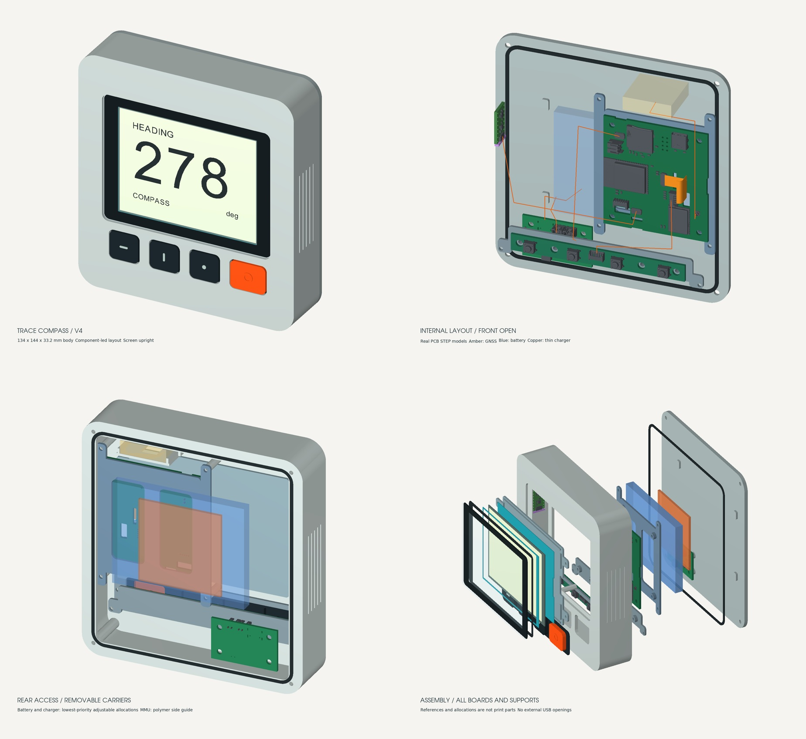

# Compass v4：按实际元件建立的外壳与装配

> **2026-11-02 更正：本版 LCD FPC 回折的针脚空间顺序不符，不能作为可装配定稿。IMU 卡槽也已在 V4.1 改为螺钉压框。先阅读 [V4.1 审计与修订](../v4_1/README.md)。以下保留原版记录；旧无干涉检查不代表屏幕插接成立。**

2026-10-31。设计输入为 `硬件/compass元件设计文件/` 中四块独立板的 STEP、Altium 导出、屏幕尺寸图、天线图及两份装配指导。按本次用户补充，**电池和薄片无线充为最低空间优先级**：先完成固定器件布局，再检查剩余空间，不用未知电池型号反向决定外壳尺寸。

本版为可检查、可打印配合样件的装配方案。四块 PCB 使用原始 STEP 实体；不是用长方体替代 PCB。电池、无线充及存在尺寸来源差异的天线使用明确标注的空间占位，不表示已选型。

## 外形与坐标

- 主体外形：**134 × 144 × 33.2 mm**；按钮凸出后的最大厚度约 33.9 mm。
- X 向右，Y 向设备顶部 / 天空，Z 朝屏幕观察者；后盖外面为 Z=0。
- 当前使用姿态假设：屏幕基本竖直，设备顶部朝天。GNSS 天线辐射面水平，法线为 +Y。倾斜安装时必须重新调整天线托面，不把固定托面视为自动水平机构。
- 后盖内面 Z=3；前框内面 Z=30.4，内部基准净深 **27.4 mm**；后盖至屏幕背面为 **27.375 mm**。符合资料中的内部 26–28 mm 目标，而不是把 26–28 mm 当整机外厚。
- 下方四键沿用易操作的大按压面，中心以实际 SW 板为准；左右壳壁有浅防滑槽。全部 Type-C 留在壳内，无外露 USB 孔。

## 元件实际安置

| 元件 | 本版位置与固定 | 依据与状态 |
|---|---|---|
| LCD | 前部横装，FPC 向右；整面软垫背托，非显示边缘前间隔垫，独立后装托盘 | **91 × 67.6 × 0.725 mm**，已替换 v3 的旧载板占位 |
| MCU PCB | 屏幕后偏右，安装在可拆聚合物托架；四个实际 3.1 mm 孔定位 | 原 STEP，含槽、器件和引脚伸出；板底 Z=18 |
| SW PCB | 四个前按键后方，独立支承架，四孔固定 | 原 STEP；孔径 4.1 mm 且接 GND，需绝缘紧固方案 |
| BAT PCB | **后盖内侧的底部区域**，平行后盖；四个支柱支承实际孔位 | 原 STEP；USB 朝壳内 +Y，避免插头顶壳壁 |
| MMU PCB | 左侧壁竖装，板面与屏幕约 90°；一体非金属卡槽和胶粘止挡 | 原 STEP；不用 16 个小孔作标准螺丝孔，不用金属螺柱 |
| GNSS 天线 | 顶部偏右的水平非金属平台，面朝 +Y；中央避空供屏蔽罩与馈线通过 | 28 × 27 × 8 mm 兼容占位，来源差异见下文 |
| 软包电池 | 后部剩余空间，避开安装柱与 BAT USB 插头 | 现阶段候选空间 **80 × 62 × 7 mm**，非采购电芯尺寸 |
| 薄片无线充 | 后盖内面，电池后方的可调整薄层区 | 现阶段候选空间 **50 × 50 × 2 mm**，未定型 |

屏幕托盘避开 FPC 根部，MCU 原有板边槽与凹槽保留。托盘、MCU 托架和 SW 托架分开，便于先装屏幕，再装电子板。BAT 固定在后盖，开盖时需要给 BAT–MCU 排线和电池线留服务余量，并先释放线束；禁止直接拉开后盖。

### 电池与无线充的最低优先级

上述包络是当前布局中检查过的剩余空间示例，不是锁定的电池仓，也不是可不留余量塞满的电芯尺寸。电池最终外包络须包含封边、保护板、引线根部、绝缘、固定和膨胀余量。后盖提供绑带锚点，可配整面软垫及可调整非金属绑带；固定力不得压伤软包。

无线充可以换成长条或更薄的形状，允许与电池重新错位。选型后再核对线圈、接收板、磁片、插头和引线的完整外形，以及充电温升和对磁力计的影响。当前两者不驱动外壳外形参数。

## 屏幕与视窗

按厂家图纸建立：裸屏右侧 FPC 端非显示区为约 4.7 mm，左侧约 1.5 mm，上下约 2 mm。AA 中心 X=0，裸屏中心 X=1.6；这是新的裸屏基准，不能沿用旧载板偏置 1.95 mm。

- AA：84.8 × 63.6 mm。
- 黑色印刷开窗：86.4 × 65.2 mm，R0.5。
- 透明盖板：104 × 78 × 1.5 mm。
- 模组参考前表面 Z=31.1；盖板内面 Z=31.6，名义间距 0.5 mm。
- 裸屏背面 Z=30.375，连续软垫厚 0.5 mm，承托板厚 1.4 mm。
- 非 FPC 端正视名义遮盖约 0.7 mm，另两侧约 1.2 mm，FPC 端约 3.9 mm。

图纸的总厚为 0.725±0.1 mm；软垫自由厚度、压缩量、像素面实际深度、印刷与装配公差仍须实测。45° 光路检查只针对所设参考面和 ±0.25 mm 对位场景，不能替代完整制造公差闭合或屏幕自身可视角测试。

## 排线、接口与维修路径

屏幕 FPC 中心路径使用实际 MCU 槽位，候选弯曲半径 2 mm，路径约 **24.18 mm**，另加 5 mm 插入及装配余量后约 29.18 mm，低于图纸外伸 32.95±0.3 mm。宽根部按 14 mm、接触尾段按 6.5 mm 建立几何候选；实际宽度变化、元件区、接触面、插入深度及允许弯曲半径仍须实物核对。**2 mm 不是厂家已确认的允许弯曲半径。**

MCU USB 预留阶梯式插入空间：短金属插头先跨过 PCB 边缘，再进入较厚的塑料尾套空间。BAT USB 预留 12 × 14 × 6 mm 插头包络，朝向壳内并避开候选电池。两处都是空间选型边界，最终插头必须复核。

`cable_routes.json` 记录 MCU–MMU、MCU–BAT、按键、GNSS、电池和无线充线束的端点与候选走向。预览中的橙色折线是规划中心线，**不是已验证弯曲半径的实物线束**。屏幕 FPC 另有实体扫掠检查。其余线路须按所选线材补充带宽、锁扣操作和服务余量；不要直接将折线长度当采购长度。

电气 pin-to-pin、FPC 接触面和反序关系沿用原装配说明；本次只做机械布置，不修改电路或针脚映射。

## 天线、传感器与资料差异

`GNSS_ANT.jpg` 标注 25 × 25 × 6.4 mm，平面尺寸图又给出 25±2 mm；制作指导写的是 26 × 28 mm 朝天面、厚 8 mm。当前用 **X=28、Z=27、Y=8 mm** 占位并留可调整托面，覆盖这两套给定平面尺寸；没有将其中任何一套误写为最终实物型号。天线平台中部已让出屏蔽罩/馈线槽，天线用非金属方式在非辐射边缘固定。

MMU 使用聚合物卡槽，止挡胶粘固定；卡槽余隙需用绝缘薄垫消除，不能让传感器自由晃动。附近紧固件需控制磁性。与其它器件的几何分离距离记录在 `validation.json`，并不表示磁干扰、无线充干扰或 GNSS 射频净空已经合格。

板坐标到整机坐标：

| 板 | 本地 +X | 本地 +Y | 本地板面法线 +Z |
|---|---|---|---|
| MCU / SW | +X | +Y | +Z |
| BAT | −Y | +X | +Z |
| MMU | +Y | +Z | +X |

这是 PCB 坐标变换；IMU 和磁力计的敏感轴还须按芯片方向、1 脚与数据手册确认后映射到固件，不能直接将板坐标当已完成校准的传感器坐标。

## 打印与试装顺序

硬件打印件共 **7 件，各 1 件**：主壳、后盖、MCU 托架、LCD 托盘、SW 托架、按键压框、MMU 止挡。透明盖板、软垫、胶层、密封圈与硅胶按键分别制作；PCB 和空间占位不是打印件。

1. 先检查四块独立 PCB 的实物轮廓、孔位与原 STEP 是否一致，特别是原说明中仍待确认的板边加工槽；不要以本次外壳验证代替 PCB DRC/DFM。
2. 主壳内先安装 MMU 和天线，检查朝向及馈线槽，暂不封死 MMU 止挡。
3. SW 托架在空壳时从后口斜转入内，放平移到下方后定位；其两侧凸耳不可直接硬挤过后口。再固定按键板，检查四键独立触发；最后装硅胶件与压框。
4. 装盖板、屏幕间隔垫、裸屏和软背垫，托盘从后口安装。不能把玻璃局部顶弯，也不能挤压 FPC 元件区。
5. MCU 托架先向左错开约 6 mm 通过后口，再平移到安装位，最后紧固；先接屏幕 FPC 并核对接触面/锁扣。不要在上紧后硬拉短排线。
6. BAT 固定在后盖支柱上，再按实际选型安置电池、无线充、绝缘及固定带。先插入 BAT USB 并连接线束，再闭合后盖。
7. 开盖复查所有线材没有夹痕、预拉力或封边受压，再进行上电与后续防护试验。

以上为装配路径方案；运动过程没有完成全连续碰撞求解，先做局部/整壳配合样件验证。孔内未建螺纹：2.4 mm / 1.6 mm 为候选底孔，需要按最终紧固件与打印工艺试配或后处理。SW 接地孔必须采用明确的绝缘或接地方案。

## 验证与交付边界

本次 **326/326 项模型检查、26/26 项导出检查通过**。`validate_v4.py` 检查实际板件与外壳/托架/预留区的实体干涉、打印件有效性与单实体连通性、原 STEP 中的安装孔、内部厚度、板姿态、45° 光路采样、屏幕 FPC 实体路径、盖板胶层整面承托、天线上方空间，以及内部 USB 插头空间。结果见 `validation.json`；13 个分件 STEP 与源码实体的对称差为零，13 个 STL 均未检出开放边或非流形边，见 `export_validation.json`。

未宣称通过：完整线束装配、连接器锁扣操作、实际按键触发行程/寿命、螺纹强度、软材压缩、盖板受压、热、射频、磁标定、跌落、盐雾或防水验证。后盖密封圈仍是压缩装配形状，不能用其厚度直接采购自由状态材料。

## 文件

- `trace_compass_v4.py`：参数化模型，含 PCB 坐标变换和各支架。
- `cadquery_out/trace_compass_v4_complete_assembly.step`：真实四板、屏幕、壳体与待选件空间占位的完整装配。
- `cadquery_out/`：分件 STEP/STL、印刷遮光 DXF、元件参考和接口空间。
- `previews/`：外观、内部布局、后部维护和爆炸视图。
- `validation.json`、`export_validation.json`：模型与交付文件检查记录。
- `inspection/pcb-datums.json`：从本次 PCB 导出读取的接口/孔位和源文件哈希。
- `references/`：本版采用的原始四板模型、屏幕图与天线图，供独立复现。
- `trace_compass_v4_rigid_print_only.zip`：7 个硬质件 STL 与试装说明。
- `trace_compass_v4_design_package.zip`：完整交付。

需要 CadQuery、VTK、Pillow。生成顺序：`python trace_compass_v4.py` → `python validate_v4.py` → `python check_exports.py` → `python render_v4.py`。原始 PCB 更新时先运行 `python prepare_inputs.py` 重新生成读取缓存和孔位记录，再重新核对固定结构；输入哈希不符时脚本会拒绝静默复用缓存。
